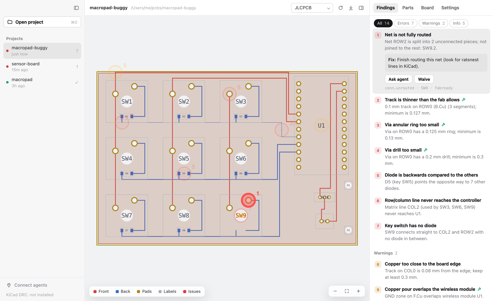

# fabready

Pre-order checks for KiCad PCBs. fabready finds the mistakes that would cost you a board order before you
place it. It runs as a desktop app, a command-line tool and an MCP server for AI agents, all built on one
Rust engine.

<picture>
  <source media="(prefers-color-scheme: dark)" srcset="docs/images/app-dark.png">
  
</picture>

## What it checks

- **Routing:** unrouted nets and footprints with no connections
- **Fab limits:** track width, via and hole sizes, and copper-to-edge clearance, against JLCPCB's limits or a
  conservative "safe" profile
- **Board:** a missing or open outline, board size and mounting holes
- **Components:** parts rated below what the board puts on them, and parts that are more than the job needs
- **Keyboards:** diodes, matrix wiring, controller pins and wireless antennas
- **KiCad DRC and ERC**, merged in when KiCad is installed

Thin tracks, undersized vias and copper under an antenna can be fixed automatically, with a preview, a
backup and undo.

## Quick start

**Desktop app** (macOS):

```bash
cd app && npm install
npx tauri build --bundles app      # fabready.app in target/release/bundle/macos/
```

Open a KiCad project folder, or drop it on the window. The app re-checks every time you save in KiCad.

**Command line:**

```bash
cargo install --path crates/fabready-cli
fabready check path/to/project
```

**AI agents:** add fabready as an MCP server so your agent can check the board and apply fixes:

```bash
claude mcp add fabready -- fabready mcp
```

Each board's settings (fab profile, limit overrides, power rails, waived findings) live in a
`fabready.json` next to it. Edit them in the app's Settings tab or by hand.

## Docs

- [Desktop app](docs/app.md): layout, fixing problems, waiving findings, shortcuts
- [Command line and MCP](docs/command-line.md): commands, output files, exit codes, agent setup
- [Configuration](docs/configuration.md): every `fabready.json` setting
- [Parts review](docs/parts.md): how components are rated
- [Keyboard PCBs](docs/keyboards.md): the extra keyboard checks and firmware helpers
- [AGENTS.md](AGENTS.md): for AI agents using fabready, and for contributors

## Privacy

fabready runs entirely on your machine and makes no network requests. It only writes:

- `fabready-out/` next to your board: reports, images, and backups made before automatic fixes
- your `.kicad_pcb`, only when you or your agent apply an automatic fix
- `fabready.json` next to your board, only when you change settings or waive a finding in the app
- `~/.fabready/agent.json`: the name of the last agent that connected over MCP, shown in the app

## Disclaimer

fabready catches common mistakes, but it doesn't replace your fab's DRC, the parts' datasheets, or your
own review. The fab profiles and part ratings are typical values and may be out of date. Always confirm
with your manufacturer before ordering. KiCad, JLCPCB and other names are trademarks of their owners, and
fabready isn't affiliated with them.

## License

[MIT](LICENSE). Third-party components and trademarks are listed in
[`THIRD-PARTY-NOTICES.md`](THIRD-PARTY-NOTICES.md).
